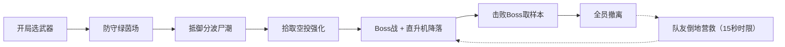
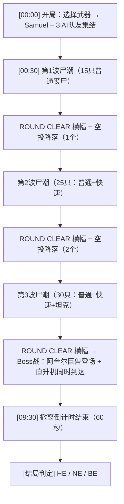
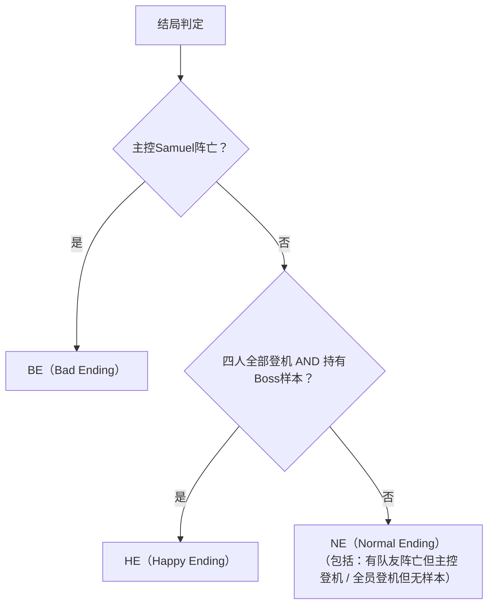
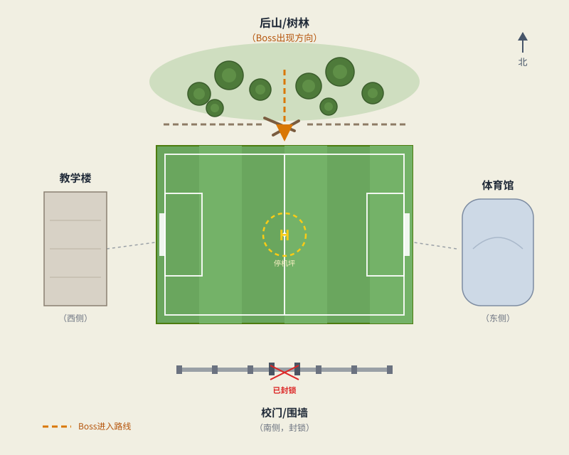
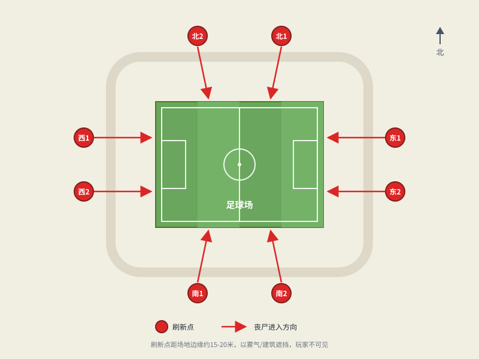
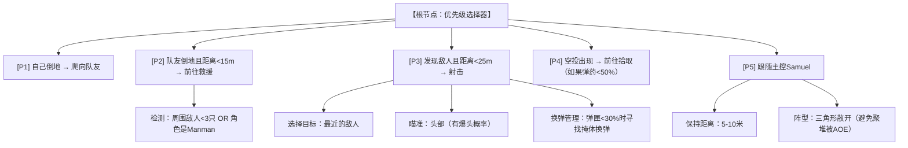

# 🎮 Chaos in School 2 Prologue: Aqueridemon

## Game Design Document (Demo Version)

### 📌 DEMO定稿

---

## 📋 文档信息

| 项目名称 | Chaos in School 2 Prologue: Aqueridemon<br>（混乱校园2前传：阿奎尔巨兽） |
| --------- | ------ |
| 简称 | CIS2 Prologue |
| 类型 | 第一人称射击(FPS) / 合作生存 / 单关Demo |
| 玩法时长 | 约10分钟 |
| 玩家人数 | 1人主控+ 3 AI队友 |
| 开发平台 | **Web（Vue3 + Tres）** |
| 目标平台 | **PC浏览器** |
| 美术风格 | 低多边形写实风格（Low-poly Realistic） |
| 开发周期 | 短期项目（非长线运营） |

---

## 🎯 核心设计

### 游戏概念（High Concept）
>
> "感染爆发的校园足球场上，四名学生幸存者必须抵御越来越强的尸潮，击败巨型章鱼Boss阿奎尔，并全员登上救援直升机。"

### 核心玩法循环



### 核心体验

- **紧张的生存压力**：持续的威胁、有限的弹药、队友的生死
- **团队配合的必要性**：救援倒地队友、分散火力、掩护撤离
- **高潮时刻**：Boss战与撤离倒计时的双重压力
- **多结局追求**：HE结局的挑战性鼓励重玩

---

## 🎬 游戏完整流程

### 主流程图



### 详细时间轴

| 游戏时间 | 事件 | 玩家状态 | 设计意图 |
| --------- | ------ | --------- | --------- |
| 0:00-0:30 | 武器选择界面 + 队友集结 | 平静准备 | 建立期待感 |
| 0:30-2:30 | 第1波（15只普通） | 热身战斗 | 熟悉操作和机制 |
| ≈2:30 | ROUND CLEAR 横幅 + 空投1个，第2波立即开始 | 短暂喘息 | 补给反馈，节奏不断 |
| 2:30-5:30 | 第2波（25只混合） | 压力提升 | 引入快速丧尸变化 |
| ≈5:30 | ROUND CLEAR 横幅 + 空投2个，第3波立即开始 | 短暂喘息 | 为高潮做准备 |
| 5:30-9:00 | 第3波（30只含坦克） | 高强度作战 | 测试团队配合 |
| ≈9:00 | Boss战 + 撤离倒计时 | **情绪最高峰** | 双重压力制造紧迫感 |
| Boss死后 | 撤离倒计时结束（60秒） | 成就感/遗憾 | 结局判定 HE / NE / BE |

> 波次之间不再设 15/20 秒间歇期：清波后只保留约 2.5 秒的 ROUND CLEAR 横幅停顿，空投在此期间投下，随后下一波立即开始。表中时间为按击杀节奏的估算值。

---

## 👥 角色设定

### 四人小队

| 编号 | 姓名 | 性别 | 身份 | 性格特点 | 主控 |
| ----- | ------ | ------ | ------ | --------- | ------ |
| #1 | **Samuel** | 男 | 普通学生 | "难以描述"的你 | ✅ 主控玩家 |
| #2 | **Football Master** | 男 | 足球校队队长 | 体能型，冲锋陷阵 | AI队友 |
| #3 | **Manman** | 女 | 学生 | 知书达理，沉着冷静 | AI队友 |
| #4 | **91Z先生** | 男 | 学生（代号） | 技巧与输出兼顾，神秘 | AI队友 |

### 角色外观建议

**Samuel（主控）**：

- 普通校服/休闲装
- 中等身材
- 配色：灰蓝色系
- 第一人称视角，身体只在影子和倒地时可见

**Football Master**：

- 足球队运动服（带队长袖标）
- 健壮体型
- 配色：运动红/橙色
- 动作风格：大开大合，冲刺速度快

**Manman**：

- 校服裙装/运动装
- 纤细身材，长发马尾
- 配色：白色+浅蓝
- 动作风格：稳定精准，走位灵活

**91Z先生**：

- 黑色卫衣+口罩（神秘感）
- 中等身材
- 配色：黑灰色系
- 动作风格：技巧性强，爆发输出

### 角色能力差异

虽然主要靠武器区分，但AI行为有微调：

| 角色 | AI倾向 | 优先武器选择 | 特殊行为 |
| ----- | ------- | ------------ | --------- |
| Football Master | 激进前压 | AK-47, MG3 | 更愿意冲锋，近距离作战 |
| Manman | 稳健支援 | QBZ-95, MP5 | 优先救援倒地队友 |
| 91Z先生 | 技巧输出 | 任意，频繁换弹 | 精准爆头率更高 |

---

## 🔫 武器系统

### 武器详细数值表

| 武器 | 类型 | 伤害/发 | 射速(RPM) | 弹匣 | 备弹 | 换弹时间 | 射程 | 后坐力 | 特点 |
| ----- | ------ | --------- | ---------- | ------ | ------ | --------- | ------ | ------- | ------ |
| **AK-47** | 突击步枪 | 35 | 600 | 30 | 120 | 2.5s | 中 | 中 | 平衡全能，可靠 |
| **MG3(银色杀手)** | 轻机枪 | 25 | 900 | 100 | 200 | 4.0s | 中远 | 高 | 火力压制，移动-20% |
| **MP5** | 冲锋枪 | 20 | 800 | 30 | 150 | 1.8s | 近中 | 低 | 灵活机动，近战优 |
| **QBZ-95** | 突击步枪 | 32 | 650 | 30 | 120 | 2.2s | 中远 | 低 | 精准射击，稳定 |

**计算说明**：

- **DPS（每秒伤害）** = 伤害 × (射速/60)
  - AK-47: 350 DPS
  - MG3: 375 DPS（但移动慢）
  - MP5: 267 DPS
  - QBZ-95: 347 DPS

- **单弹匣总伤害** = 伤害 × 弹匣
  - AK-47: 1050
  - MG3: 2500（火力最持久）
  - MP5: 600
  - QBZ-95: 960

### 武器获取与弹药机制

**开局选择**：

- 每个角色出生时选一把武器（AI自动随机或按倾向选择）
- 初始弹药：满弹匣 + 满备弹

**空投补给**：

- 第1波清空：1个空投箱（60%弹药箱 / 40%医疗包）
- 第2波清空：2个空投箱（内容同上）
- 空投箱外观：绿色军用箱，降落伞+红色烟雾标记
- 拾取方式：靠近按E键（瞬间完成）

**弹药系统（独立计数）**：

- 每人独立弹药池
- 切换武器带走当前弹药
- 空投拾取会补充该武器类型的弹药至满值
- 弹尽后武器不会消失，但无法射击（需拾取对应空投）

**爆头机制**：

- 击中头部 **×2 伤害**
- 特效：慢动作0.2秒 + 音效强化
- AI爆头率：
  - Football Master: 15%
  - Manman: 20%
  - 91Z先生: 35%

---

## 🧟 敌人设计

### 丧尸类型详细表

#### 1. 普通丧尸（Common Zombie）

| 属性 | 数值 | 说明 |
| ----- | ------ | ------ |
| 血量 | 100 HP | 被AK-47打3枪致死 |
| 移动速度 | 2 m/s | 慢速行走，玩家可轻松拉开距离 |
| 攻击方式 | 近战抓咬 | 需接触玩家 |
| 攻击伤害 | 20 HP/次 | 5次攻击致死玩家 |
| 攻击间隔 | 1.5秒 | 有反应时间 |
| 外观 | 腐烂学生 | 破烂校服，灰绿皮肤 |
| 音效 | 低沉呻吟 | 接近时警告玩家 |

**行为模式**：

- 简单追踪：朝最近玩家直线移动
- 简单避障：碰到障碍物会尝试绕行（简易射线检测）
- 聚集效应：多只丧尸会自然形成包围

#### 2. 快速丧尸（Runner）

| 属性 | 数值 | 说明 |
| ----- | ------ | ------ |
| 血量 | 70 HP | 更脆但更危险 |
| 移动速度 | 6 m/s | **比玩家跑速快** |
| 攻击方式 | 扑击 | 跃起抓咬 |
| 攻击伤害 | 15 HP/次 | 单次较低但频繁 |
| 攻击间隔 | 1.0秒 | 攻击更频繁 |
| 外观 | 瘦削快速 | 身体前倾，四肢修长 |
| 音效 | 尖锐嘶吼 | 高频警告 |

**行为模式**：

- 冲刺追击：优先攻击落单玩家
- 躲避射击：左右小幅摆动（10%概率触发）
- 突袭威胁：快速接近造成慌乱

#### 3. 坦克丧尸（Tank）

| 属性 | 数值 | 说明 |
| ----- | ------ | ------ |
| 血量 | 300 HP | 需要集火 |
| 移动速度 | 1 m/s | 非常缓慢 |
| 攻击方式 | 重击 | 双拳砸地 |
| 攻击伤害 | 40 HP + 击退3米 | 可能撞飞到危险区 |
| 攻击间隔 | 2.5秒 | 攻击前有明显前摇 |
| 外观 | 肌肉膨胀 | 体型巨大，身高2.5m |
| 音效 | 沉重脚步+吼叫 | 极具压迫感 |

**行为模式**：

- 肉盾作用：吸引火力，掩护其他丧尸接近
- 破坏掩体：可推开小型障碍物
- 处决危机：能一击打倒低血量玩家

### 波次详细设计（Web优化版）

> 三波总数 15 / 25 / 30，怪物配比沿用最初设计按比例放大；波次之间无间歇，清波后约 2.5 秒横幅停顿即开下一波。

#### 第1波：热身阶段（15只全普通）

| 时间段 | 刷新内容 | 同屏峰值 | 强化系数 |
| ------- | --------- | --------- | --------- |
| 开场 | 8只普通 | 8只 | 1.0× |
| +30秒 | 再刷7只普通 | 6-8只 | 1.0-1.05× |
| 收尾 | 清剩余 | 2-4只 | 1.05× |

**设计意图**：

- 让玩家适应射击手感
- 测试救援机制（可能有人大意受伤）
- 熟悉场地布局

#### 第2波：压力提升（25只：17普通+8快速）

| 时间段 | 刷新内容 | 同屏峰值 | 强化系数 |
| ------- | --------- | --------- | --------- |
| 开场 | 11只普通 + 6只快速 | 10-15只 | 1.0-1.08× |
| +45秒 | 再刷6只普通 + 2只快速 | 8-12只 | 1.08-1.15× |
| 收尾 | 清剩余 | 4-6只 | 1.15× |

**设计意图**：

- 引入快速丧尸打乱节奏
- 测试弹药管理能力
- 可能出现首次倒地

#### 第3波：高强度考验（30只：14普通+12快速+4坦克）

| 时间段 | 刷新内容 | 同屏峰值 | 强化系数 |
| ------- | --------- | --------- | --------- |
| 开场 | 7只普通 + 6只快速 | 10-13只 | 1.0-1.10× |
| +40秒 | 5只普通 + 5只快速 + **3只坦克登场** | 12-15只 | 1.10-1.20× |
| +100秒 | 最后2只普通 + 1只快速 + 1只坦克 | 8-12只 | 1.20× |

**设计意图**：

- 坦克的出现改变战术（需要集火）
- 极可能出现减员（测试能否撑到Boss战）
- 为Boss战创造戏剧性过渡

### 对数强化曲线

**公式**：

```
增强系数 = 1 + 0.25 × ln(1 + 当前波进度百分比 × 2)
```

**应用**：

- **血量** = 基础血量 × 增强系数
- **速度** = 基础速度 × [1 + (增强系数 - 1) × 0.3]
- **伤害** = 基础伤害 × 增强系数

**示例（第3波进行50%时）**：

- 进度 = 0.5
- 系数 = 1 + 0.25 × ln(1 + 1) = 1 + 0.25 × 0.693 = **1.173**
- 普通丧尸血量 = 100 × 1.173 = **117 HP**
- 普通丧尸速度 = 2 × [1 + 0.173 × 0.3] = **2.10 m/s**

### 刷新机制

**刷新点布局**：

- 足球场四周均匀分布 **8个刷新点**
  - 北侧（后山方向）：2个
  - 东侧（体育馆方向）：2个
  - 南侧（校门方向）：2个
  - 西侧（教学楼方向）：2个

**刷新规则**：

1. **距离限制**：距离所有玩家 > 15米
2. **视野限制**：优先在玩家视野锥外（180°后方）
3. **数量控制**：同屏敌人上限15只（Web性能考虑）
4. **补充机制**：死一个刷一个（保持压力持续）
5. **间隔时间**：每个刷新点冷却3秒

**程序化随机**：

- 刷新点激活顺序随机
- 同一刷新点可能连续刷不同类型
- 波次开始时随机选择主刷新方向（营造包围感）

---

## 👹 Boss设计：阿奎尔巨兽（Aqueridemon）

### 基础信息

| 属性 | 数值 |
| ----- | ------ |
| 名称 | 阿奎尔巨兽（Aqueridemon） |
| 类型 | 变异章鱼 |
| 总血量 | **3000 HP** |
| 出现时机 | 第3波结束，从后山爬出 |
| 体型 | 长8米（含触手），高3米 |
| 弱点 | 头部发光核心、背部核心 |

### 外观设计要点

- **主体**：巨型章鱼头部，覆盖脓疮和腐烂组织
- **触手**：8条，每条5米长，末端有吸盘和尖刺
- **发光核心**：头部中央橙红色脉动光球
- **材质**：湿润粘液质感，带病变斑块
- **动画**：触手独立摆动，头部缓慢呼吸起伏

### 战斗阶段

#### 阶段1：陆地形态（ - 50% HP）

**生命值**：3000 → 1500 HP

**移动方式**：

- 缓慢爬行（1.5 m/s）
- 触手辅助移动，有节奏感

**攻击模式循环（20秒一轮）**：

1. **触手横扫**（5秒）
   - 动作：1-2条触手大范围横向扫击
   - 伤害：50 HP + 击飞5米
   - 范围：前方120°扇形，半径8米
   - 预警：触手抬起0.8秒，有明显前摇
   - 应对：横向闪避或拉开距离

2. **触手突刺**（3秒）×2
   - 动作：单条触手快速刺向目标玩家
   - 伤害：80 HP
   - 范围：单体点名，直线攻击
   - 预警：0.5秒，触手尖端发红光
   - 应对：左右移动躲避

3. **喷射毒液**（持续6秒）
   - 动作：头部喷出绿色毒液，在地面形成3个毒池
   - 伤害：站在毒池中10 HP/秒，持续5秒
   - 范围：直径4米圆形区域×3
   - 预警：1秒，头部膨胀+咕噜声
   - 应对：离开毒池，限制走位空间

4. **召唤小怪**（瞬发，每30秒触发1次）
   - 召唤：2只快速丧尸从刷新点出现
   - 意图：分散玩家火力
   - 应对：快速清理或无视（优先打Boss）

5. **硬直期**（2秒）
   - 触发：完成一轮攻击循环后
   - 表现：Boss停顿喘息，头部核心完全暴露
   - **弱点伤害**：头部核心受到 **×2 伤害**
   - 战术时机：集火输出的黄金窗口

#### 阶段2：狂暴形态（50% - 0% HP）

**触发**：血量降至1500 HP时

**转阶段演出**（3秒）：

- Boss仰天咆哮
- 皮肤变为深红色
- 触手剧烈抽打地面
- 屏幕震动+音效高潮

**变化**：

- 移动速度提升至 **2.5 m/s**
- 攻击间隔缩短20%
- 新增技能：**全场冲击波**

**新攻击模式**：

在原有攻击基础上，新增：

**全场冲击波**（每25秒1次）

- 动作：Boss身体膨胀，猛然收缩爆发
- 伤害：50 HP + 眩晕1.5秒
- 范围：以Boss为中心，半径20米（覆盖大半个场地）
- 预警：2秒，Boss发出低频震动音，地面出现红色波纹扩散
- 应对：
  - **跳跃**可躲避冲击波（需卡时机）
  - 或跑到场地边缘（>20米）
  - 眩晕期间无法操作，极度危险

**弱点变化**：

- 冲击波释放后，Boss会趴倒3秒
- **背部核心暴露**（之前被触手遮挡）
- 背部核心受到 **×3 伤害**
- 此时是最佳输出时机

### Boss样本获取

**触发**：Boss血量归零，死亡倒地

**表现**：

1. Boss缓慢倒下，身体抽搐
2. 头部核心破裂，流出发光液体
3. 身体中央出现**发光的样本提取点**（蓝色光柱）

**拾取机制**：

- 靠近按住E键，**读条3秒**（增加紧张感）
- 读条期间无法移动和射击
- 读条被打断（受伤）需重新拾取
- 拾取成功后，Samuel背包显示"阿奎尔样本"图标（UI右上角）

**样本掉落机制**：

- Samuel（主控）死亡时，样本掉落在原地
- 其他队友可再次拾取（同样需读条3秒）
- 但主控死亡 = 游戏结束，实际上这是失败情况

---

## 🚁 撤离与结局

### 直升机机制

#### 出现时间轴

| 时间点 | 事件 | 表现 |
| ------- | ------ | ------ |
| Boss出现（7:00） | 直升机从远处飞来 | 天空出现黑点，螺旋桨声渐强 |
| +15秒（7:15） | 直升机进入场地上方 | 镜头短暂切到仰视，音效震撼 |
| +30秒（7:30） | 开始缓慢下降 | 气流吹动地面草地（粒子） |
| Boss战中 | 悬停并持续下降 | 玩家可看到舱门未开 |
| Boss死亡 | 加速降落至停机坪 | 舱门打开，舱内红光闪烁 |
| Boss死亡+10秒 | 降落完成 | 可登机，开始60秒倒计时 |

#### 停机坪位置

- **位置**：足球场中央圈（正中心）
- **标记**：地面有黄色"H"标记（提前存在）
- **半径**：5米圆形可登机区域

#### 登机操作

- 进入5米范围后，屏幕提示"按住E登机"
- 按住E键2秒读条（防止误触）
- 读条完成，角色跑向直升机，镜头切换
- 登机后玩家**锁定**，无法下来（设计决策：避免复杂性）

#### 撤离倒计时

**倒计时器**：

- 直升机降落后开始60秒倒计时
- UI显示：屏幕中央大号红色数字
- 音效：最后10秒每秒"滴答"声，最后5秒心跳声叠加

**倒计时结束**：

- 直升机强制起飞
- 未登机的角色 = 阵亡处理
- 进入结局判定

### 结局系统

#### 结局判定逻辑



#### 结局表现设计

**HE（Happy Ending）- 完美胜利**

触发条件：

- ✅ Samuel存活并登机
- ✅ Football Master存活并登机
- ✅ Manman存活并登机
- ✅ 91Z先生存活并登机
- ✅ 携带阿奎尔样本

画面表现：

1. 直升机起飞，镜头跟随上升
2. 俯视整个校园，阳光穿透云层
3. 慢动作：四人在舱内相视微笑/握拳
4. 屏幕淡出金色光晕

文字：

```
任务完成：完美撤离
阿奎尔样本已到手
所有队员安全撤离

生存者：Samuel, Football Master, Manman, 91Z先生
通关时间：XX:XX
击杀数：XXX
```

BGM：胜利感的史诗音乐，由紧张转为舒缓

---

**NE（Normal Ending）- 代价惨重的胜利**

触发条件（任一）：

- ✅ Samuel登机，但1-3名队友阵亡
- ✅ 全员登机，但未携带样本

画面表现：

*情况1：有人阵亡*

1. 直升机起飞，镜头留在地面
2. 特写：遗体/倒地角色的特写（黑白色调）
3. 舱内幸存者低头沉默的侧影
4. 屏幕淡出灰色

文字：

```
任务完成：撤离成功

阵亡者：[角色名]
幸存者：[角色名], [角色名]...

代价惨重

通关时间：XX:XX
击杀数：XXX
```

*情况2：样本遗失*

1. 直升机起飞，镜头摇向地面的Boss尸体
2. 特写：发光的样本依然在原地
3. 字幕："样本遗失，研究无法继续..."
4. 屏幕淡出暗蓝色

文字：

```
任务完成：全员撤离

但关键样本遗失
无法分析病毒源头

通关时间：XX:XX
击杀数：XXX
```

BGM：低沉的弦乐，带有遗憾感

---

**BE（Bad Ending）- 任务失败**

触发条件：

- ❌ 主控Samuel阵亡（任何时候）

画面表现：

1. 屏幕泛红，进入倒地视角（第三人称低角度）
2. 视线模糊，周围声音低沉失真
3. AI队友的呼喊声渐远（如果还活着）
4. 画面逐渐黑暗

文字：

```
任务失败

Samuel阵亡

感染继续蔓延...

生存时间：XX:XX
击杀数：XXX
```

特殊表现：

- 如果其他队友仍活着，会出现：
  - Football Master："不！撑住！"
  - Manman："Samuel！"
  - 91Z先生："该死..."
  
BGM：完全静音，只有沉重心跳声，最后一声停止

---

#### 结局统计界面

所有结局后显示统计数据：

```
========================
   战斗统计
========================

结局：[HE/NE/BE]

通关时间：09:47
总击杀数：87
  - 普通丧尸：65
  - 快速丧尸：18
  - 坦克丧尸：4

命中率：67%
爆头数：23

队友状态：
  ✅ Samuel（主控）
  ✅ Football Master
  ❌ Manman（阵亡）
  ✅ 91Z先生

Boss样本：✅ 已携带 / ❌ 遗失

========================
   [重新开始]   [退出]
========================
```

---

## 🗺️ 场景设计

### 场景总览



### 足球场详细布局

#### 尺寸与区域

**标准足球场尺寸**：100m × 70m

**功能分区**：

1. **中央停机坪**：中圈位置（直径10米），黄色"H"标记
2. **四角掩体点**：
   - 东北角：翻倒的球门 + 看台残骸
   - 东南角：堆叠的桌椅障碍
   - 西南角：废弃校车（半截）
   - 西北角：沙袋堡垒
3. **边线区域**：各类杂物散布（程序化生成）
4. **禁区外围**：刷新盲区（玩家不可进入，视觉用雾气/路障封闭）

#### 边界封锁物

**北侧（后山）**：

- 倒塌的围栏
- 大型树木横倒
- Boss从此方向爬出时会破坏部分障碍

**东侧（体育馆）**：

- 废弃汽车2-3辆
- 移动公告板

**南侧（校门）**：

- 堆叠的课桌椅（高2米的障碍墙）
- 倾斜的路灯

**西侧（教学楼）**：

- 翻倒的垃圾桶
- 临时路障（木板+铁丝网）

#### 掩体与战术要素

**掩体分布**（可程序化随机位置）：

- 中小型掩体：10-15个
  - 翻倒的长椅
  - 球门框架
  - 金属储物箱
  - 轮胎堆
  
**高度优势点**：

- 看台阶梯（北侧）：可站上去，获得1.5米高度优势
  - 优点：视野好，射击居高临下
  - 缺点：被包围时难以逃脱

**视野遮挡**：

- 中央停机坪直升机降落后会形成大型遮挡
- 掩体过多会影响视野，需要平衡

#### 空投降落点

**预设6个空投点**（程序化随机激活）：

- 点A：中圈北侧（停机坪旁）
- 点B：东侧禁区外
- 点C：西侧禁区外
- 点D：南侧底线中央
- 点E：东北角附近
- 点F：西北角附近

每次空投随机选择1-2个点激活

#### 刷新点布局

**8个主刷新点**（场地边缘外15米）：



- 每个点距离玩家活动区域15-20米
- 玩家不可见（雾气/建筑物遮挡）
- 丧尸从此刷新后"走进"场地

---

## ⚙️ 核心系统设计

### 玩家状态系统

#### 血量与伤害

| 属性 | 数值 | 说明 |
| ----- | ------ | ------ |
| 最大HP | 100 | 所有角色统一 |
| 初始HP | 100 | 满血开局 |
| 受伤来源 | 丧尸攻击、Boss攻击、毒池 | 无队友误伤 |
| 回复方式 | **无自动回血** | 被救起恢复30 HP |

#### 移动与操作

| 操作 | 数值 | 说明 |
| ----- | ------ | ------ |
| 行走速度 | 4 m/s | WASD常规移动 |
| 冲刺速度 | 7 m/s | 按住Shift |
| 冲刺体力 | 无限制 | 简化系统 |
| 跳跃高度 | 1.2 m | 可跳上看台 |
| 跳跃冷却 | 无 | 可连跳 |

#### 武器持有

- 同时持有最多2把武器
- 鼠标滚轮 / 数字键1、2切换
- 切换时间：0.5秒（手臂动画）

#### 倒地机制

**触发条件**：HP降至0

**倒地状态**：

- 视角切换为第三人称（低角度）
- 画面边缘泛红，中央显示"需要救援！"
- 倒地计时器：15秒（大号数字倒计时）
- 可缓慢爬行（1 m/s）
- 可观察战场，但无法攻击或交互

**语音提示**（如果有音频）：

- Samuel："需要支援！"
- Football Master："该死，我中弹了！"
- Manman："救救我..."
- 91Z先生："掩护我..."

**死亡判定**：

- 倒地15秒无人救援 → 彻底死亡
- 主控Samuel死亡 → 游戏结束（BE）
- AI队友死亡 → 该角色退出战斗，影响结局

#### 救援机制

**操作流程**：

1. 队友靠近倒地角色2米内
2. 屏幕提示"按住E救援"
3. 按住E键，读条3秒
4. 读条期间：
   - 救援者无法移动
   - 救援者无法射击
   - 受到攻击会打断救援（需重新开始）
5. 救援成功：
   - 被救者站起
   - 恢复30 HP
   - 2秒无敌时间（避免瞬间再次倒地）

**AI救援优先级**：

- Manman优先救人（AI行为树权重最高）
- Football Master和91Z先生会在"安全时"救援（周围敌人<3只）
- 如果多人倒地，AI选择距离最近的

---

### AI队友系统

#### 行为树结构



#### 角色AI差异化

**Football Master（激进型）**：

- 射击距离阈值：<30m（更愿意接近）
- 换弹位置：倾向于前方掩体
- 救援条件：周围敌人<2只
- 走位风格：前压，主动接近敌人

**Manman（支援型）**：

- 射击距离阈值：<25m（保持中等距离）
- 换弹位置：优先后方安全区
- 救援条件：**无视周围敌人数量**，优先救人
- 走位风格：跟随主控，保持阵型

**91Z先生（技巧型）**：

- 射击距离阈值：<28m
- 爆头率：35%（最高）
- 换弹管理：弹匣<40%就换（更保守）
- 走位风格：侧翼输出，寻找射击角度

#### AI射击精度

**基础命中率**：

- 静止目标：70%
- 移动目标：50%
- 快速丧尸：35%
- Boss弱点：20%（集火时会打到）

**爆头率**：

- Football Master：15%
- Manman：20%
- 91Z先生：35%

**射击节奏**：

- 不会"压枪"，采用点射（每次3-5发）
- 射击间隔0.5秒（模拟重新瞄准）

#### AI弹药管理

- 初始：随机选择倾向武器，满弹
- 自动换弹：弹匣空时自动执行
- 弹药消耗：从独立弹药池扣除（与玩家一致）
- 空投拾取：弹药<50%时会主动前往空投

**注意**：AI不会拾取Boss样本（设计决策，增加主控责任感）

---

### 波次管理系统

#### 波次控制器逻辑

```typescript
class WaveManager {
  currentWave: number = 0
  waveActive: boolean = false
  enemiesRemaining: number = 0
  spawnQueue: Enemy[] = []
  activeEnemies: Enemy[] = []
  
  startWave(waveNumber: number) {
    // 根据波次配置生成刷新队列
    this.spawnQueue = generateSpawnQueue(waveNumber)
    this.waveActive = true
    this.startSpawning()
  }
  
  update(deltaTime: number) {
    // 控制同屏敌人数量上限
    if (this.activeEnemies.length < MAX_CONCURRENT && this.spawnQueue.length > 0) {
      this.spawnNext()
    }
    
    // 应用对数强化
    const progress = this.getWaveProgress()
    this.applyScaling(progress)
    
    // 检测波次结束
    if (this.spawnQueue.length === 0 && this.activeEnemies.length === 0) {
      this.endWave()
    }
  }
  
  getWaveProgress(): number {
    const total = this.totalEnemiesThisWave
    const spawned = total - this.spawnQueue.length
    return spawned / total
  }
  
  applyScaling(progress: number) {
    const factor = 1 + 0.25 * Math.log(1 + progress * 2)
    // 应用到新刷新的敌人
  }
}
```

#### Round Clear 停顿

**触发**：每波清空（刷新队列刷完且本波丧尸全部死亡）

**流程**：

1. 播放波次完成提示音
2. 显示横幅："ROUND X CLEAR!"（停留约 2.5 秒）
   - 非末波副标题："下一波即将来袭"
   - 末波副标题："后山传来动静……"
3. 本波空投立即投下（第1波后1个、第2波后2个），下一波战斗中落地
4. 停顿结束后立即开始下一波；第3波清空则直接进入 Boss 登场演出

**与早期版本差异**：不再有 15/20 秒间歇期，波次之间只保留横幅停顿，全程不脱离战斗节奏。

---

### 空投系统

#### 空投生成

**触发时机**：

- 第1波清空：1个空投（ROUND CLEAR 停顿期间投下）
- 第2波清空：2个空投（同时降落不同位置）

**空投内容**（随机，不再空投武器）：

- 60%概率：弹药箱（补充当前武器弹药至满）
- 40%概率：医疗包（回复50 HP，可超过当前血量）

**空投降落**：

1. 波次清空时（ROUND CLEAR 停顿期间），天空出现飞机音效
2. 降落伞+空投箱从天而降（3秒落地）
3. 落地产生烟雾特效（红色烟雾弹）
4. 空投箱发出绿色光柱（方便寻找）

#### 拾取机制

- 靠近1米内，提示"按E拾取空投"
- 瞬间拾取（无读条）
- 拾取后空投箱消失
- 如果背包已有2把武器，需选择替换哪一把（暂停游戏，显示选择UI）

---

## 🎨 美术与技术实现

### Web端技术栈

**核心技术**：

- **前端框架**：Vue 3（Composition API）
- **3D引擎**：Tres（Three.js的Vue封装）
- **物理引擎**：简易碰撞检测（不用完整物理引擎，性能优先）
- **状态管理**：Pinia（如果需要全局状态）
- **构建工具**：Vite

### 模型规格（Web优化）

| 资源类型 | 三角面数 | 贴图分辨率 | 备注 |
| --------- | --------- | ----------- | ------ |
| 主控角色 | 5K-8K | 1024×1024 | 第一人称看不到身体，可降低 |
| AI队友 | 5K-8K | 1024×1024 | 需要看到全身 |
| 普通丧尸 | 3K-5K | 512×512 | 可复用基础模型 |
| 精英丧尸 | 5K | 512×512 | |
| Boss章鱼 | 10K-15K | 2048×2048 | 焦点角色 |
| 武器 | 2K-3K | 512×512 | 第一人称视角占比大 |
| 场景资产 | 合计<100K | 1024×1024复用 | 大量复用实例 |
| 直升机 | 8K | 1024×1024 | 远景可降级 |

### 材质与渲染

**材质类型**：

- 角色/武器：PBR材质（MeshStandardMaterial）
- 场景：简化材质（MeshLambertMaterial），降低计算
- 特效：Sprite + 半透明材质

**光照方案**：

- **环境光**（AmbientLight）：白天阳光感，强度0.6
- **方向光**（DirectionalLight）：模拟太阳，强度0.8，方向从东北斜射
- **不使用实时阴影**：性能考虑，用烘焙阴影贴图（Lightmap）

**后处理**（可选，低画质关闭）：

- 泛光（Bloom）：枪口火光、核心发光
- FXAA抗锯齿
- 色调映射

### 动画系统

**角色动画**：

- 使用Mixamo免费动画库
- 必需动画：
  - 待机、行走、奔跑、跳跃
  - 射击（站立/移动）
  - 换弹
  - 倒地、爬行、被救起
  
**敌人动画**：

- 行走、奔跑、攻击、死亡
- 坦克：沉重行走、重击、咆哮

**Boss动画**：

- 待机（触手摆动）
- 移动爬行
- 4种攻击动画
- 受伤后仰
- 死亡倒地

### 特效实现

**枪口火光**：

- Sprite + 发光材质
- 持续0.1秒，随机旋转角度
- 黄白色渐变

**弹孔与血迹**：

- Decal贴花系统
- 限制同屏数量<50个（旧的自动移除）

**毒液池**：

- 平面圆形Mesh + 绿色半透明材质
- 扭曲动画（UV滚动）
- 上方Sprite雾气粒子（<20个）

**Boss冲击波**：

- 扩散的环形Mesh
- 材质透明度渐变消失
- 地面粒子（尘土）

**空投特效**：

- 降落伞Mesh
- 落地烟雾（粒子系统，20-30个粒子）
- 光柱（圆柱体+发光材质）

### 性能优化策略

#### 渲染优化

- **着色器预编译**：开局（选枪界面期间）调用 `renderer.compile` 一次性编译全场材质；Boss、直升机、特效槽位提前挂进场景（保持不可见），登场/显形只翻可见性，消除 Boss 出现瞬间的首次编译卡顿
- **InstancedMesh**：丧尸使用实例化渲染（相同模型只提交一次）
- **LOD（多细节层次）**：
  - 距离<15m：高模
  - 15-30m：中模（面数减半）
  - >30m：低模（仅剪影）
- **视锥剔除**：Three.js自动处理
- **遮挡剔除**：简易实现，建筑物后方的敌人不渲染

#### 逻辑优化

- **对象池**：
  - 子弹对象池（复用）
  - 敌人对象池（死亡后回收）
  - 粒子对象池
- **AI更新频率**：
  - 近距离敌人：每帧更新
  - 远距离敌人：每3帧更新一次
  - Boss：每帧更新
- **碰撞检测简化**：
  - 使用包围盒（Bounding Box）而非精确网格
  - 射击检测用Raycaster（Three.js内置，高效）

#### 资源加载

- **懒加载**：分批加载资源
  - 第一批：核心资源（场景、玩家、武器、第一波敌人）
  - 第二批：后续波次敌人
  - 第三批：Boss资源
- **纹理压缩**：使用Basis Universal（.basis格式）
- **音频压缩**：MP3格式，比特率128kbps

---

## 🎵 音频设计

### 背景音乐（BGM）

| 场景 | 音乐风格 | 时长 | 说明 |
| ----- | --------- | ------ | ------ |
| 主菜单 | 阴沉氛围音 | 循环 | 低频铺垫 |
| 战斗期 | 紧张电子乐 | 循环 | 节奏120-140 BPM |
| 准备期（选枪后到第1波） | 降低音量 | - | BGM音量降至30% |
| Boss战 | 史诗管弦乐 | 2-3分钟 | 高潮段落 |
| HE结局 | 胜利进行曲 | 30秒 | 舒缓明亮 |
| NE结局 | 悲伤弦乐 | 30秒 | 低沉压抑 |
| BE结局 | 静音 | - | 只有心跳声 |

### 音效清单

#### 武器音效（每把武器）

- 射击声（单发）
- 空枪Click声
- 换弹声（退弹匣+装弹匣+拉栓）
- 弹壳掉落声

#### 敌人音效

- **普通丧尸**：呻吟、嘶吼、攻击音、死亡音
- **快速丧尸**：尖锐嘶叫、脚步声、扑击音
- **坦克丧尸**：沉重脚步、咆哮、重击音、死亡倒地

#### Boss音效

- 出场咆哮（超重低音）
- 触手横扫破风声
- 触手突刺音
- 喷射毒液咕噜声
- 召唤小怪尖啸
- 冲击波蓄力+爆发
- 受伤嘶鸣
- 死亡长啸

#### 环境音效

- 直升机螺旋桨声（由远及近，持续存在）
- 风声（环境氛围）
- 空投飞机飞过
- 空投箱落地撞击
- 脚步声（草地）
- 倒地重物音

#### UI音效

- 按钮点击
- 武器切换
- 拾取物品
- 倒地提示警告音
- 倒计时滴答声
- 波次完成提示音

### Web音频限制

**浏览器自动播放策略**：

- BGM必须在用户首次交互后播放（点击"开始游戏"）
- 音效可以播放，但首次可能需要解锁AudioContext

**实现方案**：

```typescript
// 初始化音频上下文
const audioContext = new AudioContext()

// 用户点击开始按钮后
startButton.onClick = () => {
  audioContext.resume() // 解锁音频
  bgm.play()
}
```

**同时播放限制**：

- 建议<20个音效同时播放
- 优先级系统：重要音效（受伤、Boss技能）>次要音效（脚步、远处枪声）

---

## 📊 数值平衡表（最终版）

### 玩家火力 vs 敌人数量

#### 单人理论击杀速度

| 武器 | 秒伤(DPS) | 杀普通丧尸耗时 | 杀快速丧尸耗时 | 杀坦克耗时 |
| ----- | ---------- | -------------- | -------------- | ----------- |
| AK-47 | 350 | 0.29s | 0.20s | 0.86s |
| MG3 | 375 | 0.27s | 0.19s | 0.80s |
| MP5 | 267 | 0.37s | 0.26s | 1.12s |
| QBZ-95 | 347 | 0.29s | 0.20s | 0.87s |

*基于命中率，实际×70%精度*

#### 四人团队火力（理想状态）

- 总DPS：~1400（假设平均武器）
- 杀Boss理论时间：3000 HP ÷ 1400 DPS = **2.14秒**（全程集火弱点×2）
- 实际Boss战时间：考虑走位、躲技能、射偏 → **60-90秒**

### 波次生存压力

#### 第3波中段（第二批次投入后）

**敌人配置**：

- 同屏峰值约13只（5普通 + 5快速 + 3坦克）
- 理论总伤害潜力（伤害 ÷ 攻击间隔）：
  - 普通：5 × (20/1.5 ≈ 13) ≈ 67 DPS
  - 快速：5 × (15/1 = 15) = 75 DPS
  - 坦克：3 × (40/2.5 = 16) = 48 DPS
  - **合计 ≈ 190 DPS**

**玩家总血量**：4人 × 100 HP = 400 HP

**理论生存时间**（若完全不击杀敌人）：

- 400 ÷ 190 ≈ **2.1秒**

**实际情况**：

- AI队友会分摊火力
- 击杀敌人降低压力
- 合理走位避免集火
- **实际安全时间约30-40秒**（符合波次时长设计）

### Boss战平衡

#### Boss血量与火力需求

**3000 HP分解**：

- 阶段1（1500 HP）：
  - 硬直期集火（×2伤害）：4人全力输出30秒可削减1200 HP
  - 常规射击（×1伤害）：补充300 HP
  - 小计约50秒
  
- 阶段2（1500 HP）：
  - 冲击波后集火（×3伤害）：4人25秒可削减1200 HP
  - 常规射击：补充300 HP
  - 小计约40秒

**总计Boss战时长**：90秒左右（符合60秒倒计时 + 一定提前量）

#### 弹药消耗

**以AK-47为例**：

- 初始弹药：30+120 = 150发
- 击杀第1波（15只）：约130发（含射偏）
- 第1波清空空投+补充：满弹
- 击杀第2波（25只）：约230发
- 第2波清空空投+补充：满弹
- 击杀第3波（30只）：约280发（大概率弹尽）
- Boss战：需要空投补充

**设计意图**：弹药比早期版本更紧张，必须合理拾取空投（AI队友的击杀可分摊主控的弹药消耗）

---

## 🎓 设计哲学

### 为什么这样设计？

#### 10分钟的时长选择

- ✅ 快速完整体验，适合Demo展示
- ✅ 易于测试迭代
- ✅ 高重玩价值（挑战HE）
- ✅ 不会疲劳（节奏紧凑）

#### 主控死亡=游戏结束

- ✅ 简化AI逻辑（不需处理主控切换）
- ✅ 强化生存压力（你是核心）
- ✅ 符合叙事定位（Samuel是主角）
- ✅ 技术实现简单

#### 独立弹药系统

- ✅ 增加资源管理深度
- ✅ 空投拾取更有价值
- ✅ 武器选择有权衡（MG3弹药多但移动慢）
- ❌ 缺点：需要额外UI显示备弹

#### 三结局设计

- **HE**：完美主义玩家的目标，挑战难度高（全员存活+样本）
- **NE**：大部分玩家的结局，有成就感但也有遗憾
- **BE**：失败反馈，但不会太挫败（可以快速重开）

#### 对数曲线强化

- 避免线性增长的乏味
- 前期增长较快，建立压力
- 后期增速放缓，不至于过于困难
- 符合玩家能力成长曲线

---

## 🔧 开发建议

### 推荐开发顺序

#### 第一Phase：核心玩法（MVP）

1. **Stage 1-2**：场景搭建 + 第一人称控制器
   - 足球场基础场景（白盒）
   - WASD移动 + 鼠标视角
   - 跳跃、冲刺

2. **Stage 3-4**：武器与射击
   - Raycaster射击检测
   - 一把武器（AK-47）完整实现
   - 弹药系统、换弹
   - 准星UI

3. **Stage 5**：敌人基础
   - 一种丧尸（普通）
   - 简单AI追踪
   - 血量与死亡

4. **Stage 6-7**：波次系统
   - 波次管理器
   - 手动触发3波测试
   - 同屏敌人数量控制

**里程碑1**：可以在场地上抵御3波丧尸

---

#### 第二Phase：扩展内容

1. **Stage 8-9**：完整武器系统
   - 补充其余3把武器
   - 武器切换UI
   - 空投系统

2. **Stage 10**：倒地与救援
   - 倒地状态
   - 队友AI救援逻辑

3. **Stage 11-12**：敌人多样化
   - 快速丧尸 + 坦克丧尸
   - 对数强化逻辑

4. **Stage 13-14**：Boss战（初版）
   - Boss模型与基础移动
   - 1-2个攻击模式
   - 弱点伤害机制

**里程碑2**：完整波次+简化Boss可通关

---

#### 第三Phase：完善与打磨

1. **Stage 15-16**：Boss战完整实现
   - 所有攻击模式
   - 阶段转换
   - 样本机制

2. **Stage 17-18**：撤离与结局
   - 直升机动画
   - 登机机制
   - 三结局逻辑与画面

3. **Stage 19-20**：AI队友完善
   - 三个角色差异化
   - 行为树调优

4. **Stage 21**：UI完善
   - HUD（血条、弹药、队友状态）
   - 倒计时
   - 波次提示

**里程碑3**：功能完整，可测试通关流程

---

#### 第四Phase：优化与收尾

1. **Stage 22-23**：音效与音乐
   - 集成所有音效
   - BGM切换逻辑

2. **Stage 24-25**：性能优化
   - 对象池实现
   - LOD调整
   - 测试帧率（目标30+ FPS）

3. **Stage 26-27**：视觉打磨
   - 特效优化
   - 光照调整
   - 后处理效果

4. **Stage 28**：测试与修Bug
   - 完整流程测试
   - 三结局测试
   - 边缘情况修复

**最终交付**：完整可玩Demo

---

### 技术风险点

| 风险 | 概率 | 影响 | 应对方案 |
| ----- | ------ | ------ | --------- |
| Web端性能不足 | 高 | 高 | 提前做压力测试，降低同屏数量 |
| AI寻路卡住 | 中 | 中 | 简化寻路，用简单追踪+碰撞检测 |
| Boss战帧数暴跌 | 中 | 高 | Boss单独优化，降低特效复杂度 |
| 音频兼容性问题 | 低 | 中 | 提供降级方案（无BGM模式） |
| 加载时间过长 | 中 | 中 | 资源懒加载，显示进度条 |

---

## 📝 需要进一步补充的内容

*茄子标记了一些可选的扩展方向*

### 叙事与世界观

- 感染是怎么爆发的？
- 阿奎尔巨兽的由来？（实验失败？海洋污染？）
- 为什么只有这四个学生幸存？
- 后续CIS2正篇的剧情走向？

**【待定：是否需要环境叙事（场景中的日记、广播、涂鸦）？】**

### 可选功能（如果时间允许）

- 简易教学关卡（30秒射击训练+救援训练）
- 战斗中的语音互动（队友喊话："小心左边！""弹药不多了！"）
- 击杀连续技提示（Double Kill!）
- 战绩分享卡片（Canvas生成图片）
- 无尽模式（HE解锁，纯粹撑波数）

**【待定：哪些功能优先级高？】**

---

## 📞 文档状态

| 项目 | 完成度 |
| ----- | -------- |
| 核心玩法设计 | ✅ |
| 角色设定 | ✅ |
| 武器系统 | ✅ |
| 敌人设计 | ✅ |
| Boss设计 | ✅ |
| 结局系统 | ✅ |
| 场景布局 | ✅ |
| AI系统 | ✅ |
| 数值平衡 | ✅ |
| 技术方案 | ✅ |
| 音频设计 | ✅ |
| 美术规格 | ✅ |

---
