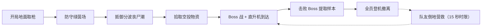
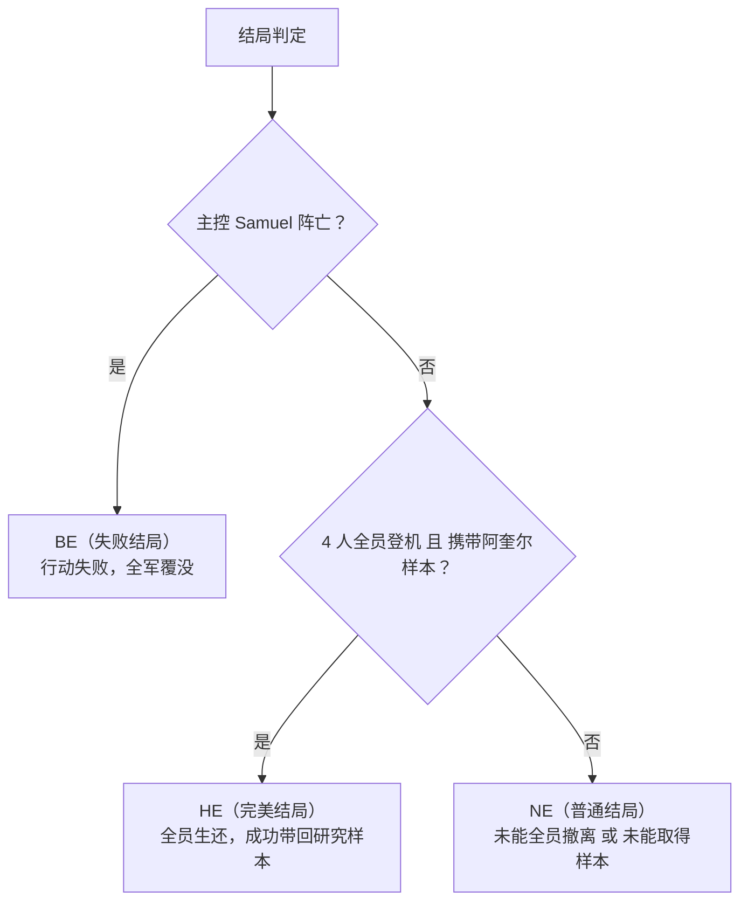

# 《混沌校园2前传：阿奎尔巨兽》游戏设计规范（Game Design Spec）

> 本文档由开发团队与协作助手共同维护，作为游戏核心机制、数值与系统实现的基准规范。

---

## 1. 游戏概述与核心循环

- **项目定位**：四人合作第一人称生存射击单关演示版（基于 Web / PC 浏览器）。
- **故事背景与目标**：在感染爆发的校园足球场上，4 名学生幸存者建立防线，抵御不断增强的丧尸潮，拾取空投补给，迎击巨型章鱼 Boss 阿奎尔，最终搭乘救援直升机撤离。
- **核心体验**：生存压迫感、小队倒地营救配合、Boss 战与撤离倒计时的多重紧张节奏，以及追求全员撤离完美结局（HE）的挑战乐趣。

### 核心循环流转

---

## 2. 角色设定与小队协同

### 小队成员

| 编号 | 姓名 | 身份 | 行为风格与 AI 倾向 | 控制类型 |
| :--- | :--- | :--- | :--- | :--- |
| #1 | **Samuel** | 普通学生 | 第一人称视角，操作射击与战场决策 | 主控玩家 |
| #2 | **Football Master** | 足球校队队长 | 冲锋型，偏好 AK-47 与 MG3，擅长近距离压制 | AI 队友 |
| #3 | **Manman** | 沉着学生 | 支援型，偏好 QBZ-95 与 MP5，优先营救倒地队友 | AI 队友 |
| #4 | **91Z先生** | 神秘学生 | 技巧型，走位灵活，爆头率高（约 35%） | AI 队友 |

### 协同机制与倒地营救

- **倒地营救**：玩家或 AI 队友生命值归零时进入倒地濒死状态，倒计时 15 秒；队友靠近按住互动键即可施救，超时未营救则判定阵亡。
- **状态显示**：准星指向队友时，准星右侧简洁显示队友信息：`Name: [队友名] HP: [生命值百分比]%`，不遮挡战斗视野。

---

## 3. 武器系统与补给规则

### 主武器数值表

| 武器 | 类型 | 单发伤害 | 射速 (RPM) | 弹匣容量 | 换弹时间 | 射程 | 特点 |
| :--- | :--- | :--- | :--- | :--- | :--- | :--- | :--- |
| **AK-47** | 突击步枪 | 35 | 600 | 30 发 | 2.5 秒 | 中距离 | 威力均衡，全能可靠 |
| **MG3** | 轻机枪 | 25 | 900 | 100 发 | 4.0 秒 | 中远距离 | 弹容量大，火力压制，持枪移动略慢 |
| **MP5** | 冲锋枪 | 20 | 800 | 30 发 | 1.8 秒 | 近中距离 | 机动灵活，射速高，换弹快 |
| **QBZ-95** | 突击步枪 | 32 | 650 | 30 发 | 2.2 秒 | 中远距离 | 后坐力低，点射精准 |

- **命中与爆头**：命中丧尸头部触发 2 倍暴击伤害。
- **携行与备弹限制**：每名角色可同时携带 2 把主武器；每把武器的备弹上限统一为 6 个满额弹匣。

### 开局取枪规则

- **箱体布局**：开局场地中圈南侧并排摆开 8 个主武器硬箱，小队 4 人各对准前方两箱。
- **开箱机制**：开箱即获得该随机主武器并补满子弹；AI 队友各自拾取自己正前方的箱子，不争抢主控箱位。
- **静默开局**：进入战场后静默 3 秒直接开启第 1 波防守，不设倒计时横幅，拾取武器后无冗余弹窗阻碍视线。

### 空投补给规则

- **分阶段空投投放**：
  - 普通波次空投：只投放主武器箱与弹药箱。
  - Boss 战空投：只投放弹药箱与医疗包箱。
- **箱型外观识别**：
  - 弹药箱：橄榄绿军用补给箱，配降落伞。
  - 主武器箱：炭灰硬质箱，配橙色锁扣，顶盖印有步枪剪影与主武器标识。
  - 医疗包箱：白色急救箱，各面带有蓝色十字标识。

---

## 4. 敌人类型与波次推进

### 丧尸类型

1. **普通丧尸**：生命值 100 HP，移速 2 m/s，近战攻击 20 HP/次（攻击间隔 1.5 秒），数量多，容易形成包围。
2. **快速丧尸**：生命值 70 HP，移速 6 m/s（快于玩家基础奔跑速度），近战扑击 15 HP/次（攻击间隔 1.0 秒），机动突袭制造混乱。
3. **坦克丧尸**：生命值 300 HP，移速 1 m/s，重拳砸地 40 HP 并附带 3 米击退效果，前摇明显，作为团队集火目标。

### 波次配置

波次之间不设冗长的休整倒计时；清波后保留约 2.5 秒的过关提示停顿，空投物资随即投下，下一波紧接着开始。

| 波次 | 敌人构成 | 刷新规模 | 战斗节奏与设计意图 |
| :--- | :--- | :--- | :--- |
| **第 1 波** | 15 只普通丧尸 | 分批次入场，同屏峰值 8 只 | 熟悉基础射击手感与足球场地貌，空投 1 个补给箱 |
| **第 2 波** | 25 只（17 普通 + 8 快速） | 同屏峰值 10–15 只 | 快速丧尸入场打乱防守阵型，考验走位与弹药管理，空投 2 个补给箱 |
| **第 3 波** | 30 只（14 普通 + 12 快速 + 4 坦克） | 坦克陆续入场，同屏峰值 12–15 只 | 坦克充当肉盾掩护尸群，需要团队集火与相互拉扯，为 Boss 战铺垫高潮 |

- **刷新与性能**：足球场四周设 8 个刷新点，优先在玩家视野外且距离大于 15 米处生成；同屏敌人上限严格控制在 15 只，兼顾战斗压迫感与 Web 端运行帧率。
- **动态曲线**：随波次进度深入，敌人生命值与移速按对数曲线平稳增强。

---

## 5. Boss 战：阿奎尔巨兽

### 基础属性与弱点

- **生命值**：3000 HP。
- **外观特征**：巨型变异章鱼形态，头部带有发光核心，背部藏有核心弱点。
- **弱点判定**：攻击发光核心可造成额外暴击伤害。

### 战斗阶段

#### 阶段 1：常态对决（100% – 50% 生命值）
- **触手横扫**：前方扇形广角横扫，造成 50 HP 伤害并击退 5 米。
- **触手突刺**：单条触手直线点名穿刺，造成 80 HP 高额单体伤害。
- **喷射毒液**：在地面产生 3 处毒池，站在其中持续受到腐蚀伤害，限制团队走位空间。
- **召唤干扰**：周期性召唤快速丧尸入场牵制火力。
- **硬直破绽**：攻击循环结束后 Boss 出现短暂停顿，头部核心完全暴露，承受 2 倍弱点伤害。

#### 阶段 2：狂暴状态（50% – 0% 生命值）
- **转阶段表现**：Boss 仰天咆哮，表皮泛红，移动速度提升至 2.5 m/s，技能冷却大幅缩短。
- **全场冲击波**：身体蓄力猛缩后爆发震波，波及半径 20 米，造成 50 HP 伤害与眩晕；玩家需看准前摇起跳规避。
- **背部暴露**：释放冲击波后 Boss 趴倒 3 秒，背部核心暴露，承受 3 倍暴击伤害，是团队集火的最佳窗口。

### 样本提取

Boss 倒地死亡后，躯体中央升起蓝色光柱提取点。主控 Samuel 需靠近按住互动键引导 3 秒完成提取；提取完成是达成完美结局的关键先决条件。

---

## 6. 直升机撤离与多结局判定

### 撤离流程

1. **直升机进场**：Boss 战打响后直升机抵达足球场上空盘旋。
2. **停机降落**：Boss 死亡后直升机迅速降落至足球场中央圈停机坪（黄色 H 标识）。
3. **倒计时登机**：降落完成立即启动 60 秒登机倒计时；幸存队员进入停机坪范围按住互动键即可登机。

### 结局判定条件

- **HE（完美结局）**：小队 4 人全员存活登机，且成功采集到阿奎尔样本。
- **NE（普通结局）**：主控 Samuel 成功撤离，但有队友阵亡，或未能提取样本。
- **BE（失败结局）**：主控 Samuel 阵亡，或未能在 60 秒倒计时结束前登机。

---

## 7. 界面、交互与视听体验

### 主菜单与 3D 背景

- **布局与音效**：主菜单采用左侧纯文字布局，鼠标悬停选项带有音效。
- **3D 战场背景**：实时渲染足球场地俯视运镜，带有镜头平移与鼠标视差效果；在主页、玩法、设置、关于与音乐鉴赏页面间跳转时背景保持常驻不重载。
- **背景音乐**：主界面循环播放原版管弦配乐，进入游戏或音乐鉴赏页时淡出停止，返回菜单后自动恢复，音量跟随设置调节。

### 音乐鉴赏页面

- **曲目收录**：收录回合战斗、Boss 战、闲时与原版配乐四首曲目。
- **交互控制**：支持播放、暂停与进度条拖拽跳转；播放时界面暖色光晕与背景画面随音乐节拍起伏律动。

### 全屏加载体验

- **全屏遮罩**：进入游戏或重新开局时全屏覆盖，实时展示当前准备阶段与百分比进度，加载完毕平滑淡入战场，避免黑屏与画面闪烁。

### 结局结算与导航

- **结算面板**：通关或阵亡后弹出结算面板，呈现击杀数据与结局类型。
- **操作按钮**：包含“再来一局”（重新开局进入加载）、“制作人员”（前往关于页查看团队成员分工、游戏简介与技术鸣谢）以及“退出”（返回标题页）。
- **玩法介绍与关于页**：关于页支持中英文双语团队信息展示；玩法介绍页支持在页面内流畅滚动浏览。

---

## 8. 未来演进规划

- 扩展校园足球场周边建筑与看台高低差掩体，提供更多战术迂回路线。
- 引入更多丧尸变种与特种突变机制。
- 增加武器配件改装系统与战术投掷道具。
